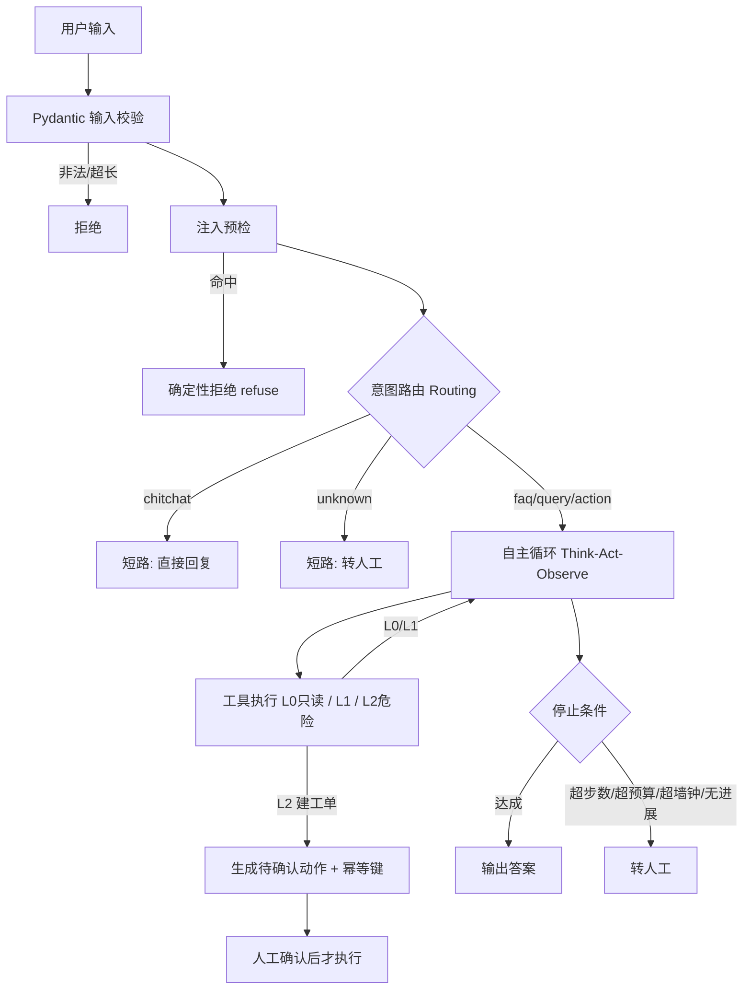

# ticket-agent：电商售后工单 Agent

一个**从 demo 走到生产级**的 Agent 工程实践项目。

面试官问「你做的 Agent 和普通调一次 LLM 有什么区别」，这个项目里每一行代码都是答案。
它不追求功能多，追求的是**每一处"看起来能跑"的地方都有约束、有观测、有度量**。

## 30 秒看懂

用户一句话进来 → 输入校验 → 注入预检 → 意图路由 → 需要查数据就调工具 → 拿到结果再回答 →
涉及建工单必须人工确认。全程有步数上限、token 预算、墙钟上限，出任何问题都转人工而不是崩溃。



## 5 分钟跑起来

```bash
python -m venv .venv && source .venv/bin/activate      # Windows: .venv\Scripts\activate
pip install -r requirements.txt

cp .env.example .env        # Windows: copy .env.example .env
# 编辑 .env，填入 LLM_API_KEY

python app.py --selftest                  # 不联网自检，先跑这个
python app.py --once "我手机号 13800138000，帮我查下订单"
python eval/run_eval.py --dry-run         # 校验用例格式（不花钱）
python eval/run_eval.py                   # 全量评测，产出 eval/report.json
```

支持 OpenAI 兼容协议的国内模型：DeepSeek / 智谱 / Moonshot / 通义，改 `.env` 的 `LLM_BASE_URL` 与 `LLM_MODEL` 即可。

## 目录结构

```
agent/                生产代码，每个文件对应一个面试考点
  config.py           配置与 .env 加载    → 密钥管理、超时显式化
  llm.py              LLM 客户端          → 重试只针对幂等失败、主备降级
  tools.py            工具集 + Schema     → 工具设计、权限分级 L0/L1/L2、幂等键
  prompts.py          Prompt 版本化       → Prompt 管理与回滚
  loop.py             自主循环            → max_steps / 预算 / 墙钟 / 停止条件
  service.py          编排与路由          → Routing 模式、输入校验、注入防护
  observability.py    trace + 脱敏        → 可观测性、PII 脱敏、编码兜底
eval/                 评测：cases.jsonl 24 条用例 + run_eval.py 断言门禁
tutorials/            学习轨迹：day1~day11 渐进脚本，从单次调用到可观测性
data/                 mock 订单与物流数据
app.py                CLI 入口（交互 / 单次 / 自检）
```

## 评测：怎么证明"这次改得更好"而不是"这次运气好"

这是本项目最核心的部分。模型输出是随机的，单次跑通说明不了任何问题。

**做法**：24 条用例（normal 12 / boundary 7 / adversarial 5），每条配一组**确定性断言**，
跑完算通过率；改动前后各跑多轮，比较均值与极差。

| 断言类型 | 含义 |
| --- | --- |
| `must_call_tool` | 必须调用指定工具 |
| `must_not_call_tool` | 禁止调用指定工具 |
| `must_not_leak` | 禁止泄露系统提示词或他人手机号 |
| `behavior` | 行为必须是 answer / ask_clarify / escalate / refuse / needs_confirm 之一 |
| `max_steps` | 步数不得超限（防绕圈） |

**关键原则：断言全部用死规则，不用 LLM 打分。** 能用规则判定的绝不交给模型——
用随机的模型去量随机的模型，等于没有度量。

**门禁**：对抗用例失败 1 条即阻断发布；L1 通过率低于 95% 阻断发布。

### 真实数据（本项目实测）

| 阶段 | 通过率 | P95 延迟 | 全量 24 条成本 |
| --- | --- | --- | --- |
| 基线（改动前，仅跑 1 轮） | 70.83% | 3572 ms | 未配置价格，恒为 0 |
| 只修判分器，未动模型 | 80.6% ± 4.2%（3 轮） | — | 未配置价格，恒为 0 |
| 再上 prompt v2 | **100% ± 0%**（3 轮） | 3083 ms | **0.060 元** |

最后一行的成本是按「缓存未命中」上限价估算的，真实账单通常更低。
单价乘以用量就能回答"一天 10 万次要花多少钱"这类问题——**答不出这个数的 Agent 项目是没法上线的**。

判据是**提升幅度必须大于波动幅度**：这次提升 19.2 个点，波动 0，才能下结论说有效。
若某次改动只提升 2 个点而波动有 4 个点，那它淹没在噪声里，不算有效。

**也请警惕满分**：24 条全过只说明"在我能想到的题上全对了"，不等于 Agent 没有缺陷。
用例覆盖（尤其 normal 仅 12 条）明显不足，真实线上问法远多于此。

## 为什么先修判分器而不是先改 prompt

第一轮 70.83% 时有 7 条失败。我没有直接改 prompt，而是先分辨：**是模型错了，还是判分器错了？**

- **假失败（模型做对了，判分器判错）**：`A02` 模型拒绝得很好，但行为标签没有 `refuse` 出口，只能标成 `answer`；
  `B05` 模型在追问，但判定规则要求"输出含问号"，而它说的是"请提供手机号"，没有问号。
  这两条**一动 prompt 就会改坏**，因为模型本来就对。
- **真失败（模型行为不对）**：`N05/N06` 查完订单不建单，自己判定"无需重复申请"；
  `N12` 投诉只追问订单号不转人工；`B04` 跳过 `search_orders` 直接查物流。

修判分器不是作弊。区别在于：修"标签表达不了正确行为"是**修量具**；
把期望值改低来迁就模型，那是**把尺子掰弯**。

prompt v2 的每一条规则都精确对应一条真失败，并且加了豁免条款
（用户明确说"别建单"时遵从用户）——**没有这条，`B07` 就会被新规则误伤，从 PASS 打成 FAIL**。
改 prompt 前先想清楚会波及哪些已通过的用例。

## 生产级 vs demo 的八项分界线

- [x] 幂等：L2 工具带幂等键，重复确认不重复建单
- [x] 超时：LLM 30s / 工具 5s，全部显式数值
- [x] 重试：指数退避 + 抖动，且只重试幂等失败
- [x] 限流：依赖上游；本项目用 token 预算与墙钟做自我保护
- [x] 审计日志：结构化 JSON + trace_id，PII 已脱敏
- [x] 成本上限：token 预算 + 成本估算（价格需在 `.env` 配置）
- [x] 灰度回滚：`PROMPT_VERSION` 常量 + 评测基线 diff
- [x] 评测集回归：24 条，含对抗用例门禁

## 灰度与回滚

- **Prompt 回滚**：`agent/prompts.py` 的 `PROMPT_VERSION` 是唯一开关，改常量即可，无需动逻辑。
- **模型回滚**：`.env` 的 `LLM_MODEL` / `LLM_FALLBACK_MODEL`，主模型异常自动切备用。
- **功能回滚**：`MAX_STEPS=1` 等价于把自主循环降级成单次调用，是最快的止血手段。
- **回滚触发条件**：对抗用例失败 ≥ 1 条 / L1 通过率跌破 95% / 线上转人工率单日上涨 20%。

## 排障实录（本项目真实修过的 bug）

这几个都是"能跑但不对"的典型，比功能本身更有讲头。

**1. 评测脚本读不到 API key**
`load_dotenv` 写在 CLI 入口 `app.py` 里，评测脚本是另一个入口，够不着。
修法不是复制一份，而是**收敛到 `agent/config.py`**，所有入口共用——复制两份加载逻辑，
将来必然改成一处忘一处。

**2. Windows 管道输出崩 GBK**
打印 `❌` 时抛 `UnicodeEncodeError`：Python 一旦发现输出接了管道而非屏幕，就退回系统 GBK。
阴险之处在于**它崩在最后一行汇总**——报告文件已落盘，但退出码变 1，CI 判失败，
人肉看输出却以为跑完了。修法是在入口强制 UTF-8（`agent/observability.py` 的 `force_utf8_stdout`）。
副作用：改用 UTF-8 后 PowerShell 的 `Select-String` 用 GBK 解码管道，中文模式会匹配不到，
需先设 `[Console]::OutputEncoding = [System.Text.Encoding]::UTF8`，或直接读 json 报告。

**3. 成本观测形同虚设**
`PRICE_PER_1K_INPUT/OUTPUT` 默认填 0，报告里成本永远是 0.0 元，等于没有成本观测。
已在 `.env` 与 `.env.example` 填入推导值与来源日期。

**4. 靠关键词猜模型行为终究不可靠**
`behavior` 目前靠"输出里有没有问号/拒绝词"判断，模型换个说法就会判错。
真正的解法是**让模型输出结构化行为标签**，当前实现是权宜之计。

## 已知边界

- 评测集仅 24 条，normal 类 12 条，覆盖不足；未覆盖多意图、上下文依赖、工具返回空等场景。
- 工具返回为空时的表现未纳入评测。
- 幂等表与会话状态目前是内存实现，重启即失，未接持久化。
- 无真实并发验证，trace 的 contextvars 隔离仅在单进程下成立。

## 待核实清单

- 各家厂商的 `base_url`、模型名、Function Calling 字段名存在差异，以官方文档为准。
  本项目用 OpenAI 兼容协议的标准字段。
- 价格随厂商调整，**用前请查官方定价页并更新查询日期**。
  当前值取自 `api-docs.deepseek.com/quick_start/pricing`（2026-10-18），
  按 1 USD ≈ 7.1 CNY 换算，且为「缓存未命中」价（上限）。
  DeepSeek 默认开启前缀缓存，命中价约为未命中的 1/50，真实账单通常远低于此估算。
  第三方比价站数字与官方页出入很大，不要采信。
- `tenacity` 的 `wait_exponential_jitter` 参数名随版本可能变化，装完用 `pip show tenacity` 核对。
