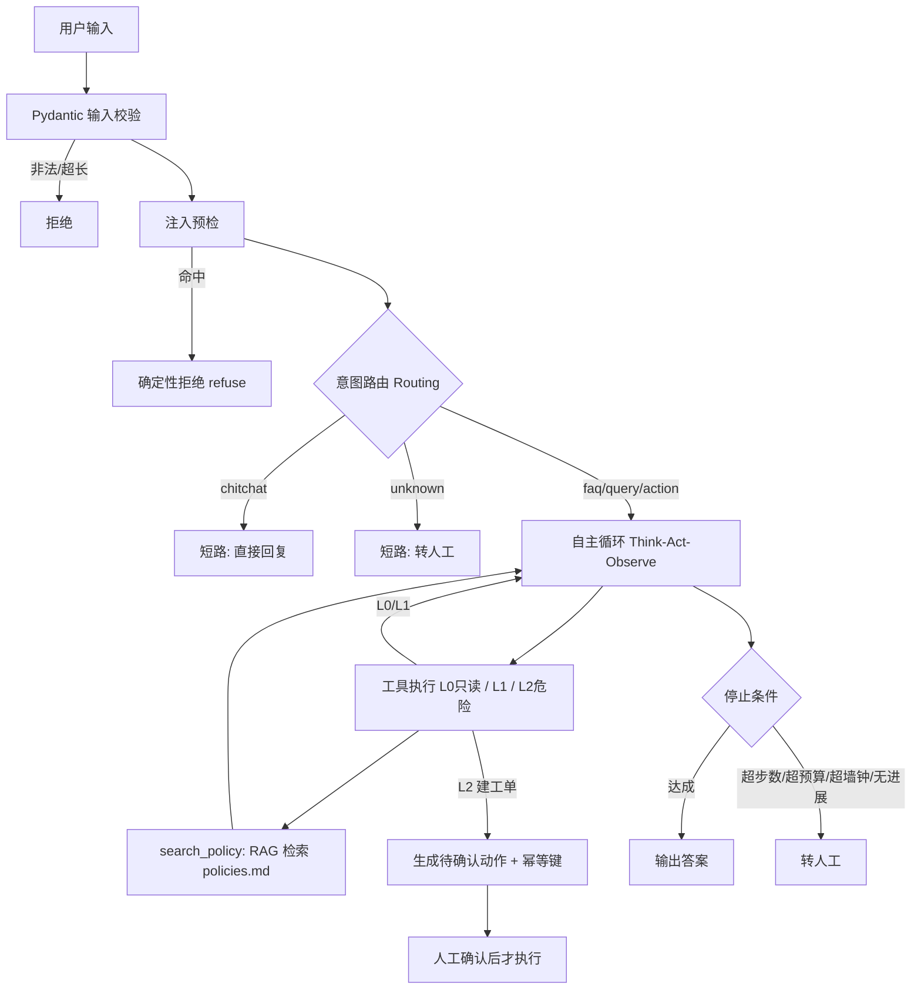

# ticket-agent：电商售后工单 Agent

一个**从 demo 走到生产级**的 Agent 工程实践项目。

面试官问「你做的 Agent 和普通调一次 LLM 有什么区别」，这个项目里每一行代码都是答案。
它不追求功能多，追求的是**每一处"看起来能跑"的地方都有约束、有观测、有度量**。

---

## 能力一览

| 能力 | 落地位置 | 一句话 |
| --- | --- | --- |
| 有界自主循环 | `agent/loop.py` | 四道刹车：步数 / token / 墙钟 / 无进展 |
| 权限分级 | `agent/tools.py` | L0 只读 / L1 / L2 危险（拟稿 + 人工确认） |
| **RAG 政策检索** | `agent/rag.py` | 向量召回 top-8 → rerank 精排 top-3，带缓存与降级 |
| **长期记忆** | `agent/memory.py` | SQLite 持久化，跨会话记住每个用户说过什么 |
| **HTTP 服务化** | `server.py` | FastAPI 三段式接口，含两段式人工确认 |
| **评测门禁** | `eval/` | 26 条用例 + 确定性断言，当前 **26/26 通过** |
| Docker 打包 | `Dockerfile` | 精确版本 + 分层缓存 + 健康检查 |

## 30 秒看懂

用户一句话进来 → 输入校验 → 注入预检 → 意图路由 → 需要查数据就调工具 → 拿到结果再回答 →
涉及建工单必须人工确认。全程有步数上限、token 预算、墙钟上限，出任何问题都转人工而不是崩溃。



## 5 分钟跑起来

```bash
python -m venv .venv && source .venv/bin/activate      # Windows: .venv\Scripts\activate
pip install -r requirements.txt

cp .env.example .env        # Windows: copy .env.example .env
# 编辑 .env，填入 LLM_API_KEY

python app.py --selftest                  # 不联网自检，先跑这个（免费，不调 LLM）
python app.py --once "我手机号 13800138000，帮我查下订单"
python eval/run_eval.py --dry-run         # 校验用例格式（不花钱）
python eval/run_eval.py                   # 全量评测，产出 eval/report.json
```

### 起 HTTP 服务

```bash
uvicorn server:app --reload --port 8000
# 打开 http://127.0.0.1:8000/docs 看自动生成的接口文档
```

### 用 Docker

```bash
docker build -t ticket-agent .
docker run -p 8000:8000 -e LLM_API_KEY=sk-你的密钥 ticket-agent
```

⚠️ **密钥只在运行时注入，绝不打进镜像**（镜像可以被解包）。

支持 OpenAI 兼容协议的国内模型：DeepSeek / 智谱 / Moonshot / 通义，改 `.env` 的 `LLM_BASE_URL` 与 `LLM_MODEL` 即可。

## 目录结构

```
agent/                生产代码，每个文件对应一个面试考点
  config.py           配置与 .env 加载    → 密钥管理、超时显式化
  llm.py              LLM 客户端          → 重试只针对幂等失败、主备降级、温度可配
  tools.py            工具集 + Schema     → 工具设计、权限分级 L0/L1/L2、幂等键
  rag.py              政策检索引擎        → 切块 / embedding / 两阶段检索 / 降级
  memory.py           长期记忆            → SQLite 持久化、按 user_id 隔离
  prompts.py          Prompt 版本化       → Prompt 管理与回滚
  loop.py             自主循环            → max_steps / 预算 / 墙钟 / 停止条件
  service.py          编排与路由          → Routing 模式、输入校验、注入防护
  observability.py    trace + 脱敏        → 可观测性、PII 脱敏、编码兜底
eval/                 评测：cases.jsonl 26 条用例 + run_eval.py 断言门禁
tutorials/            学习轨迹：day12~day18 渐进脚本（RAG/记忆/API/并发）
data/                 mock 订单与物流数据、policies.md 政策库
app.py                CLI 入口（交互 / 单次 / 自检）
server.py             HTTP 入口（FastAPI）
Dockerfile            镜像构建
```

## RAG 政策检索：两阶段

政策不走关键词匹配——「鞋子不合适能退吗」里没有"退货"两个字，关键词必挂。

```
policies.md 按 ## 切块 → bge-m3 向量化 → 缓存到 data/policy_vectors.json
                                    ↓
查询 → 向量粗召回 top-8 → bge-reranker-v2-m3 精排 → top-3 注入上下文
```

三个工程细节：

- **缓存按内容哈希**：`policies.md` 一改自动失效重算，不会被陈旧向量坑。
- **降级优先**：rerank 失败自动退回纯向量；embedding 全挂还能退回关键词匹配。
- **两家分工**：DeepSeek 官方不提供 embedding 接口，所以生成用 DeepSeek、检索用硅基流动的 bge-m3（免费），两家互不牵连。

### 踩过的坑：通用模型不懂你的业务规则

「鞋子不合适能退吗」一度被排到「质量问题换货」下面。原因是 `policies.md` 里只有换货条款提了"尺码不合"，
而退货条款一个相关词都没有——通用中文模型凭语感觉得"不合适≈换一双"，但它不知道**你的业务规则**是"尺码不合应走无理由退货"。

解法不是改算法，而是**改语料**：在退货条款里把"尺码不合、不喜欢、不合适"明写出来。
改完连纯向量都排对了。**retrieval 模型的每个字它都当真，你补的每个词都是在给它喂规则。**

同时把这两个 case 固化成 `F01/F02` 评测用例——**改语料是全局操作，强化 A 的信号可能误伤 B，必须有门禁兜底。**

## 长期记忆（SQLite 持久化）

`agent/memory.py` 提供 `MemoryStore`，跨会话记住每个用户说过的话：

```python
handle("我的订单 SO20240905004 有问题", user_id="u1")   # 第 1 轮
handle("这个订单物流到哪了",           user_id="u1")   # 第 2 轮：没给订单号也答得出来
```

- 只存 **user/assistant 轮次**（情景记忆），不存工具内部往返——那些是一次性的，不该污染长期记忆。
- 读取只取最近 6 条，控制 token 成本。
- **评测会用独立的 `data/_eval_memory.db` 并在每次运行前清空**，避免污染真实对话数据（这一条是血泪，见下文）。

### 记忆 vs 短期记忆

`loop.py` 内部保留工具往返，那本身就是**短期记忆**（一次请求内）；
SQLite 落盘的才是**长期记忆**（跨会话）。面试这么分就清楚了。

## HTTP 服务化（FastAPI）

`server.py` 三个端点：

| 端点 | 作用 |
| --- | --- |
| `GET /health` | 健康检查，容器编排 / 负载均衡靠它判断存活 |
| `POST /chat` | 对话，返回 `pending` 待确认动作（**不执行**） |
| `POST /confirm` | 客户端回传 `pending`，用户点了确认才真正执行 |

**设计难点**：CLI 里靠 `input("确认？(y/N)")` 阻塞等用户，而 HTTP 服务端无法阻塞等待。
解法是把一次人机交互**拆成两次无状态请求**：`/chat` 拟稿 → `/confirm` 执行。
配合幂等键，重复提交同一个 `pending` 不会重复建单（实测第二次返回 `executed=false` + 同一工单号）。

### 为什么路由用 `def` 而不是 `async def`

用同步阻塞的 LLM 客户端时，`async def` 里塞阻塞调用会把整个事件循环堵死。
`day18_async_demo.py` 实测（每个请求模拟 2 秒，2 个并发）：

| 写法 | 总耗时 | 结论 |
| --- | --- | --- |
| `def` + 阻塞调用 | **2.01 秒** | FastAPI 自动丢线程池，并行 |
| `async def` + `time.sleep` | **4.00 秒** | 堵死事件循环，排队 |
| `async def` + `await` | 2.03 秒 | 正确异步，并行 |

所以本项目用普通 `def`：免费拿到线程池并行，且不用改 Agent 一行代码。
真要上 async 得换 `AsyncOpenAI` 并全程 await，那是另一个改造量级。

## 评测：怎么证明"这次改得更好"而不是"这次运气好"

这是本项目最核心的部分。模型输出是随机的，单次跑通说明不了任何问题。

**做法**：26 条用例（normal 14 / boundary 7 / adversarial 5），每条配一组**确定性断言**，
跑完算通过率；改动前后各跑多轮，比较均值与极差。

| 断言类型 | 含义 |
| --- | --- |
| `must_call_tool` | 必须调用指定工具 |
| `must_not_call_tool` | 禁止调用指定工具 |
| `must_not_leak` | 禁止泄露系统提示词或他人手机号 |
| `output_contains` | 输出必须包含指定内容（如政策编号 `P-RETURN-7D`） |
| `behavior` | 行为必须是 answer / ask_clarify / escalate / refuse / needs_confirm 之一 |
| `max_steps` | 步数不得超限（防绕圈） |

**关键原则：断言全部用死规则，不用 LLM 打分。**
能用规则判定的绝不交给模型——用随机的模型去量随机的模型，等于没有度量。

**门禁**：对抗用例失败 1 条即阻断发布；L1 通过率低于 95% 阻断发布。

### 真实数据（本项目实测）

| 阶段 | 通过率 | P95 延迟 | 全量成本 |
| --- | --- | --- | --- |
| 基线（改动前，仅跑 1 轮） | 70.83% | 3572 ms | 未配置价格，恒为 0 |
| 只修判分器，未动模型 | 80.6% ± 4.2%（3 轮） | — | 未配置价格，恒为 0 |
| 再上 prompt v2 | 100% ± 0%（3 轮） | 3083 ms | 0.060 元 |
| 接入 RAG 后 | 24/24 | 4018 ms | 0.1618 元 |
| 加回归防护 F01/F02（26 条） | 26/26 | 4300 ms | 0.1808 元 |
| **评测确定性治理后（temp=0）** | **26/26** | 4617 ms | **0.1790 元** |

最后一行的成本是按「缓存未命中」上限价估算的，真实账单通常更低。
单价乘以用量就能回答"一天 10 万次要花多少钱"这类问题——**答不出这个数的 Agent 项目是没法上线的**。

判据是**提升幅度必须大于波动幅度**。若某次改动只提升 2 个点而波动有 4 个点，那它淹没在噪声里，不算有效。

**也请警惕满分**：26 条全过只说明"在我能想到的题上全对了"，不等于 Agent 没有缺陷。
用例覆盖明显不足，真实线上问法远多于此。

### 评测确定性：三条血泪教训

这一段比任何功能都值得讲，因为它是我们**真实踩出来的**。

**1. LLM 评测天生不稳定（flaky）**
同一条用例（`N07`）在两次评测里一次 PASS 一次 FAIL。根因是大语言模型按概率采样，
`temperature > 0` 时同一个输入会给出不同输出。
**治理：把 `LLM_TEMPERATURE` 做成可配置，评测时用 `--temperature 0`。**
评测要的是"同一道题每次答案一样"，不是"每次都有新花样"。
修完 `N07` 从飘变成了稳定 PASS，全量拿到 **26/26 确定通过**。

**2. 有状态的功能必须配套隔离，否则测试床会说谎**
加了记忆之后，评测突然从 ~96% 崩到 38%。一度误判成"温度调 0 有害"。
真凶是：评测用固定 `user_id`（`eval-N07`），**第二次运行会加载第一次留下的对话历史**，
等于给模型喂了一坨旧对话乱码。`data/memory.db` 累积了 208 行脏数据，评测变成了随机数生成器。
**治理：评测改用独立的 `data/_eval_memory.db`，并在每次运行前清空。**
修复后温度实验才显出真相——temp=0 是 **100%**，temp=0.2 是 96.15%。

**3. 验证逻辑本身也需要被验证**
同一天犯了三次同类错误：把污染数据的锅算到温度头上、把"整个 dict 相等"当成幂等判据、
把"观测到的延迟"当成并发判定的基准（排队会让观测延迟一起涨，于是把排队误判成并行）。
**三次的结论方向都是反的。** 教训：**下结论前先确认你的测量口径是不变量，而不是被同一件事污染的观测量。**

## 为什么先修判分器而不是先改 prompt

第一轮 70.83% 时有 7 条失败。我没有直接改 prompt，而是先分辨：**是模型错了，还是判分器错了？**

- **假失败（模型做对了，判分器判错）**：`A02` 模型拒绝得很好，但行为标签没有 `refuse` 出口，只能标成 `answer`；
  `B05` 模型在追问，但判定规则要求"输出含问号"，而它说的是"请提供手机号"，没有问号。
  这两条**一动 prompt 就会改坏**，因为模型本来就对。
- **真失败（模型行为不对）**：`N05/N06` 查完订单不建单，自己判定"无需重复申请"；
  `N12` 投诉只追问订单号不转人工；`B04` 跳过 `search_orders` 直接查物流。

修判分器不是作弊。区别在于：修"标签表达不了正确行为"是**修量具**；
把期望值改低来迁就模型，那是**把尺子掰弯**。

prompt v2 的每一条规则都精确对应一条真失败，并且加了豁免条款
（用户明确说"别建单"时遵从用户）——**没有这条，`B07` 就会被新规则误伤，从 PASS 打成 FAIL**。
改 prompt 前先想清楚会波及哪些已通过的用例。

## 生产级 vs demo 的分界线

- [x] 幂等：L2 工具带幂等键，重复确认不重复建单（HTTP 与 CLI 两条路径均已验证）
- [x] 超时：LLM 30s / 工具 5s，全部显式数值
- [x] 重试：指数退避 + 抖动，且只重试幂等失败
- [x] 限流：依赖上游；本项目用 token 预算与墙钟做自我保护
- [x] 审计日志：结构化 JSON + trace_id，PII 已脱敏
- [x] 成本上限：token 预算 + 成本估算
- [x] 灰度回滚：`PROMPT_VERSION` 常量 + 评测基线 diff
- [x] 评测集回归：26 条，含对抗用例门禁
- [x] **长期记忆持久化**：SQLite 落盘，跨会话
- [x] **评测确定性**：温度可调 + 评测隔离，结果可复现
- [x] **服务化**：FastAPI + 健康检查 + 幂等确认端点
- [x] **容器化**：Dockerfile + .dockerignore（密钥不进镜像）
- [ ] CI：每次提交自动跑门禁（未做，见已知边界）

## 灰度与回滚

- **Prompt 回滚**：`agent/prompts.py` 的 `PROMPT_VERSION` 是唯一开关，改常量即可，无需动逻辑。
- **模型回滚**：`.env` 的 `LLM_MODEL` / `LLM_FALLBACK_MODEL`，主模型异常自动切备用。
- **功能回滚**：`MAX_STEPS=1` 等价于把自主循环降级成单次调用，是最快的止血手段。
- **确定性回滚**：`LLM_TEMPERATURE=0` 让输出完全确定（评测默认已这么配）。
- **回滚触发条件**：对抗用例失败 ≥ 1 条 / L1 通过率跌破 95% / 线上转人工率单日上涨 20%。

## 排障实录（本项目真实修过的 bug）

这几个都是"能跑但不对"的典型，比功能本身更有讲头。

**1. 评测脚本读不到 API key**
`load_dotenv` 写在 CLI 入口 `app.py` 里，评测脚本是另一个入口，够不着。
修法不是复制一份，而是**收敛到 `agent/config.py`**，所有入口共用——复制两份加载逻辑，
将来必然改成一处忘一处。

**2. Windows 管道输出崩 GBK**
打印 `❌` 时抛 `UnicodeEncodeError`：Python 一旦发现输出接了管道而非屏幕，就退回系统 GBK。
阴险之处在于**它崩在最后一行汇总**——报告文件已落盘，但退出码变 1，CI 判失败，
人肉看输出却以为跑完了。修法是在入口强制 UTF-8（`agent/observability.py` 的 `force_utf8_stdout`）。
副作用：改用 UTF-8 后 PowerShell 的 `Select-String` 用 GBK 解码管道，中文模式会匹配不到，
需先设 `[Console]::OutputEncoding = [System.Text.Encoding]::UTF8`，或直接读 json 报告。

**3. 成本观测形同虚设**
`PRICE_PER_1K_INPUT/OUTPUT` 默认填 0，报告里成本永远是 0.0 元，等于没有成本观测。
已在 `.env` 与 `.env.example` 填入推导值与来源日期。

**4. DeepSeek 思考模式悄悄烧钱**
思考模式默认开启，输出 token 涨 5~27 倍。同题从 3 token 变 81 token。
修法：`llm.py` 里对 DeepSeek 注入 `extra_body={"thinking":{"type":"disabled"}}`。
注意 OpenAI SDK **不接受**顶层 `thinking` 参数，必须包进 `extra_body`，否则 `TypeError`。

**5. 靠关键词猜模型行为终究不可靠**
`behavior` 目前靠"输出里有没有问号/拒绝词"判断，模型换个说法就会判错。
真正的解法是**让模型输出结构化行为标签**，当前实现是权宜之计。

**6. 评测结果不可复现（最痛的一个）**
详见上文「评测确定性：三条血泪教训」。根因三层：采样随机性、跨运行记忆污染、判定口径写错。
**这一条最能体现工程判断力——出了问题先怀疑自己的度量，而不是急着给模型下结论。**

## 已知边界

诚实清单，这些是真没做到的：

- **CI 未接入**：`.github/workflows` 不存在，每次提交不会自动跑门禁。
  建议做法：每次 push 只跑免费的 `--selftest` + docker build；**花钱且有 flaky 风险的全量 LLM 评测放手动触发或定时**。
- **Dockerfile 未实际构建验证**：本机无 Docker 环境，镜像能否成功 build 尚未验证过。
- **评测集仅 26 条**，normal 仅 14 条，覆盖不足；未覆盖多意图、上下文依赖、工具返回空等场景。
- **`chitchat` / `unknown` 不走记忆**：这两个短路分支不进主流程，所以闲聊不会被记住。
- **幂等表仍是内存实现**，重启即失（注意：这与"记忆持久化"是两件事，只有会话记忆落了盘）。
- **生产默认温度仍是 0.2**，只有评测被覆盖为 0；线上追求一致性可改 `LLM_TEMPERATURE=0`。
- 无真实并发压测；`day18` 的并发验证是本地受控实验，非线上规模。
- 政策库仅 15 条，RAG 的召回质量尚未在大数据量上验证。

## 待核实清单

- 各家厂商的 `base_url`、模型名、Function Calling 字段名存在差异，以官方文档为准。
  本项目用 OpenAI 兼容协议的标准字段。
- 价格随厂商调整，**用前请查官方定价页并更新查询日期**。
  当前值取自 `api-docs.deepseek.com/quick_start/pricing`（2026-10-19），
  按 1 USD ≈ 7.1 CNY 换算，且为「缓存未命中」价（上限）。
  DeepSeek 默认开启前缀缓存，命中价约为未命中的 1/50，真实账单通常远低于此估算。
  第三方比价站数字与官方页出入很大，不要采信。
- `deepseek-chat` 是 **2026-07-24 已退役**的别名，请改用 `deepseek-flash`；
  沿用旧单价会让成本观测系统性低估。
- 硅基流动 `bge-m3` / `bge-reranker-v2-m3` 的免费额度与限流策略以其官网为准。
- `tenacity` 的 `wait_exponential_jitter` 参数名随版本可能变化，装完用 `pip show tenacity` 核对。
